  

  <picture>
    <source media="(prefers-color-scheme: dark)" srcset="./assets/description-dark.svg">
    <source media="(prefers-color-scheme: light)" srcset="./assets/description-light.svg">
    
  </picture>

 

  <picture>
    <source media="(prefers-color-scheme: dark)" srcset="./assets/tools-skills-dark.svg">
    <source media="(prefers-color-scheme: light)" srcset="./assets/tools-skills-light.svg">
    
  </picture>

  &nbsp;&nbsp;&nbsp;
  &nbsp;&nbsp;&nbsp;
  &nbsp;&nbsp;&nbsp;
  &nbsp;&nbsp;&nbsp;
  &nbsp;&nbsp;&nbsp;
  &nbsp;&nbsp;&nbsp;
  &nbsp;&nbsp;&nbsp;
  &nbsp;&nbsp;&nbsp;
  

 

  <picture>
    <source media="(prefers-color-scheme: dark)" srcset="./assets/certifications-title-dark.svg">
    <source media="(prefers-color-scheme: light)" srcset="./assets/certifications-title-light.svg">
    
  </picture>

  &nbsp;&nbsp;&nbsp;&nbsp;
  &nbsp;&nbsp;&nbsp;&nbsp;
  &nbsp;&nbsp;&nbsp;&nbsp;
  

 

  <picture>
    <source media="(prefers-color-scheme: dark)" srcset="./assets/stats-title-dark.svg">
    <source media="(prefers-color-scheme: light)" srcset="./assets/stats-title-light.svg">
    
  </picture>

  <picture>
    <source media="(prefers-color-scheme: dark)" srcset="./assets/stats-dark.svg">
    <source media="(prefers-color-scheme: light)" srcset="./assets/stats-light.svg">
    
  </picture>

 

  <picture>
    <source media="(prefers-color-scheme: dark)" srcset="./assets/links-title-dark.svg">
    <source media="(prefers-color-scheme: light)" srcset="./assets/links-title-light.svg">
    
  </picture>

  &nbsp;
  &nbsp;
  

 

  <picture>
    <source media="(prefers-color-scheme: dark)" srcset="./assets/thank-you-dark.svg">
    <source media="(prefers-color-scheme: light)" srcset="./assets/thank-you-light.svg">
    
  </picture>

 

  

